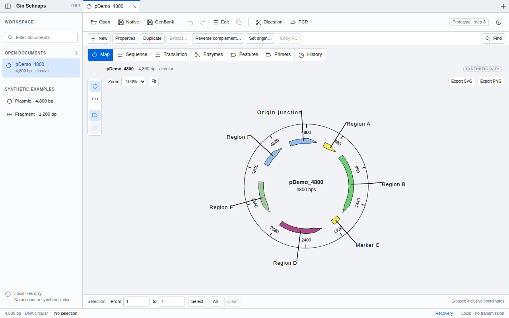

# Gin Schnaps

An open-source, local-first DNA and plasmid workbench for macOS, Windows and Linux.
View annotated maps, inspect and edit sequences, manage oligonucleotides, and run
basic translation, restriction and theoretical PCR analyses. The interface is in English.

**Gin Schnaps is a development preview, not a laboratory-validated release.**
Keep independent backups. Desktop packages are not signed by a trusted publisher.

Source on `main` may be newer than the public preview. Download only an asset from a published release.

## Download and install

**[Download published Gin Schnaps previews](https://github.com/MOMISBACK/gin-schnaps/releases)**

The table below describes the package types. Select the version actually listed on the releases page; source changes are not available until their release is published. The current changes are documented in [CHANGELOG](CHANGELOG.md).

Choose a file from **Assets** on that release page. In the table, `VERSION` means
the number printed on the release you selected (not text to type into a URL):

| Your system | Download | Start |
|---|---|---|
| Mac with an Intel processor | `gin-schnaps-VERSION-macos-intel.dmg` | Open the disk image; drag **Gin Schnaps.app** to **Applications**. |
| Mac with Apple Silicon | `gin-schnaps-VERSION-macos-arm64.dmg` | Open the disk image; drag **Gin Schnaps.app** to **Applications**. |
| Windows x64 | `gin-schnaps-VERSION-windows-x64.zip` | Extract the ZIP; open **Gin Schnaps.exe**. WebView2 is required. |
| Any system with a compatible browser | `gin-schnaps-VERSION-browser.zip` | Extract the ZIP; open **index.html**. No server or development tools. |
| Ubuntu 24.04-compatible Linux x64 | `gin-schnaps-VERSION-linux-x64.tar.gz` | Extract and launch **gin-schnaps**; GTK3/WebKitGTK 4.1 required. Experimental; see the security note below. |

**GitHub's “Code → Download ZIP” and the “Source code” assets are for developers.**
They are not the ready-to-run application. Older Macs can use the browser package;
native compatibility with every older macOS version has not been established.

[Portable backups](docs/DOCUMENT_BACKUPS.md) · [Installation and troubleshooting](docs/INSTALL.md) · [Installation acceptance checklist](docs/INSTALLATION_CHECKLIST.md) · [First steps](docs/USER_GUIDE.md)

## What it does

- Circular/linear maps with mouse-wheel zoom and drag panning, sequence tracks and a resizable side-by-side workspace.
- Select all, cut/copy/paste, direct IUPAC base typing in an explicit edit mode and undo/redo with document-aware keyboard controls.
- Cross-document base-sequence copy/paste with preview, insertion/replacement and undo.
- Guarded sequence/annotation editing, undo/redo, motif search, extraction,
  reverse complement, origin changes, and SVG/PNG map export.
- FASTA/plain DNA, documented GenBank/EMBL subsets, partial `.dna` import, and `.sg.json` documents.
- Six-frame/CDS translation with codes 1 and 11, 16 restriction enzymes,
  exact theoretical PCR, saved oligo libraries and one saved PCR setup per document.
- Create a document from a selected PCR product, with feature-transfer preview and saved provenance.
- Native Open/Save/Save As on desktop; opt-in local recovery. No account or sequence upload.

[File compatibility](docs/FILE_FORMATS.md) · [Scientific scope](docs/SCIENCE.md) · [PCR product documents](docs/PCR_PRODUCTS.md)

## Important limits

Primer3/Tm, automatic primer design, Sanger chromatograms, assembly, direct typing
into nucleotide rows, automatic updates and file associations are not implemented.
Complex annotations have explicit editing restrictions. A simulated product is
not evidence that an experiment will succeed.

The Linux desktop dependency tree includes a known GLib memory-safety warning;
reachability is not established. Use it only as a development preview, not with
sensitive files. See [security and privacy](SECURITY.md) for the full status.

To move existing work, export `.sg.json` documents before replacing an older
application or folder. Recovery storage does not migrate automatically.

## Contribute

[Build and test](docs/DEVELOPMENT.md) · [Contributing](CONTRIBUTING.md) ·
[Report an issue](https://github.com/MOMISBACK/gin-schnaps/issues/new/choose) ·
[Roadmap](docs/ROADMAP.md)

Own code: **GPL-3.0-or-later**. Dependencies and public test fixtures retain their
licenses; see [LICENSE](LICENSE) and [third-party notices](THIRD_PARTY_NOTICES.md).
